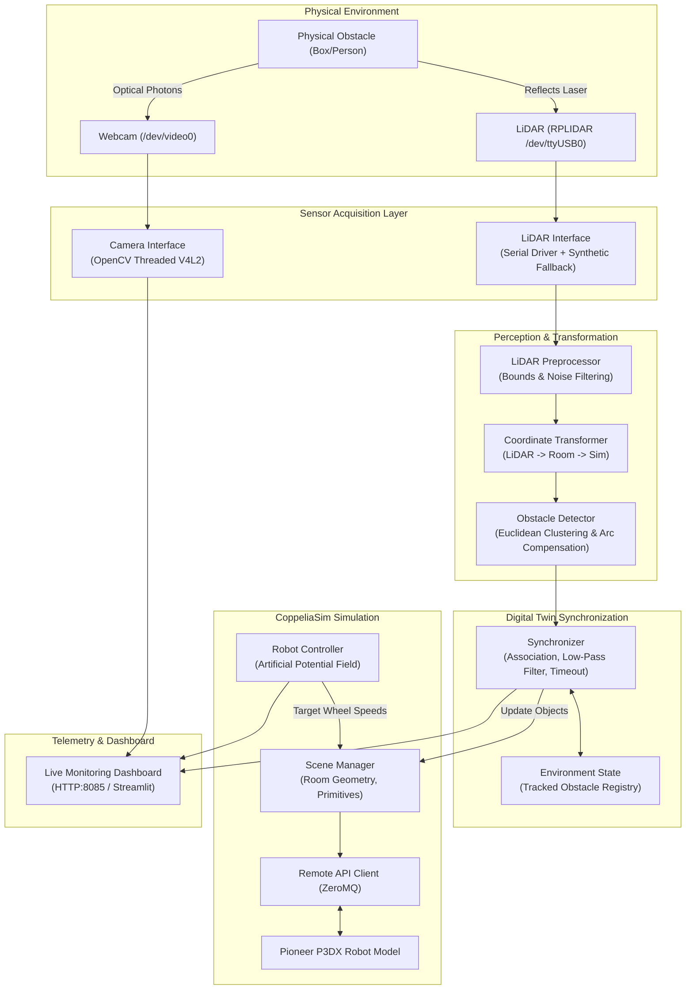

# System Architecture: Real-Time Digital Twin of a Physical Room

## 1. System Overview

The system establishes a closed-loop digital twin that continuously mirrors a physical laboratory room inside CoppeliaSim, enabling an autonomous mobile robot to plan and react in real time to physical environmental changes.

---

## 2. Module Specifications

### Module A: Physical Sensor Acquisition
- **Camera Interface (`sensors/camera_interface.py`):** Threaded OpenCV capture over V4L2 (`/dev/video0`) capturing up to 1280x720 / 640x480 @ 30 FPS with non-blocking frame retrieval to prevent queue latency.
- **LiDAR Interface (`sensors/lidar_interface.py`):** Native pure Python driver decoding RPLIDAR A1/A2 packets over serial port (`/dev/ttyUSB0`) with transparent high-fidelity synthetic emulation fallback when disconnected.

### Module B & C: Perception and Coordinate Transformations
- **LiDAR Processing (`perception/lidar_processing.py`):** Filters non-finite points, range thresholds ($[0.15, 10.0]$ m), and clips perimeter wall boundaries to isolate free-space obstacles.
- **Coordinate Transformer (`calibration/coordinate_transforms.py`):** Rigid transformations from LiDAR polar $(r, \theta)$ to Cartesian sensor frame $(x_s, y_s)$, then to Physical Room frame $(x_{room}, y_{room})$, and into CoppeliaSim world coordinates.
- **Obstacle Detector (`perception/obstacle_detection.py`):** 2D Euclidean clustering with arc-center compensation ($p_{center} = p_{arc} + \frac{2}{\pi} R \hat{u}_{los}$) to recover true cylinder geometric centers from front-surface reflections.

### Module D: Digital-Twin State and Synchronizer
- **Environment State (`digital_twin/environment_state.py`):** Central repository for tracked obstacles with confidence, observation history, and lifecycle metrics.
- **Synchronizer (`digital_twin/synchronizer.py`):**
  - **Association:** Nearest-neighbor matching within $d_{assoc} = 0.45$ m.
  - **Filtering:** Exponential moving average position smoothing ($\alpha = 0.65$).
  - **Temporal Confirmation:** Requires $N=2$ consecutive scans before instantiating objects in CoppeliaSim, preventing sensor noise flicker.
  - **Obstacle Pruning:** Retains unobserved obstacles for a persistence timeout ($t_{timeout} = 2.0$ s) to prevent premature deletion during beam dropouts.

### Module E & F: Simulation and Autonomous Navigation
- **Scene Manager (`simulation/scene_manager.py`):** Programmatically constructs walls, floor, goal marker, and loads Pioneer P3DX robot. Dynamically creates/updates obstacle cylinders via CoppeliaSim ZeroMQ API.
- **Robot Controller (`navigation/robot_controller.py`):** Differential-drive kinematics combined with Artificial Potential Field (APF) guidance. Generates attractive forces towards goal and repulsive deflection away from physical obstacles. Stops when obstacles are within critical stop distance ($0.38$ m).

### Module G: Monitoring Dashboard
- **Web Dashboard (`dashboard/app.py`):** Pure-Python HTTP server providing real-time MJPEG camera stream, 2D interactive radar canvas, obstacle list, robot telemetry, and interactive controls on `http://localhost:8085`.
